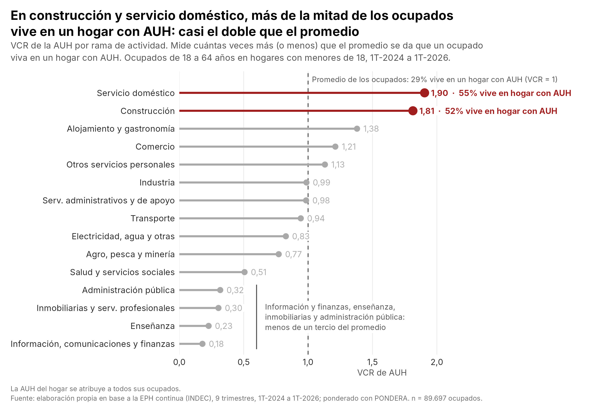
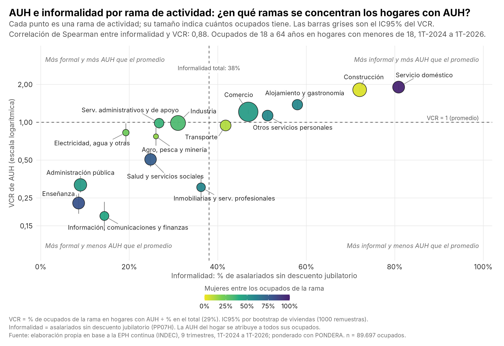

# AUH, desigualdad del ingreso e inserción sectorial en hogares con menores

Trabajo Práctico Integrador — Ciencia de Datos para Economía y Negocios (FCE-UBA)

## Integrantes

- Joaquín Alvaredo
- Pedro Viladomat
- Valentín Díaz Arroyo

Grupo 17.

## Objetivo

Describir en qué se parecen y en qué se diferencian los hogares con menores de 18 años que cobran la Asignación Universal por Hijo (AUH) respecto del resto, mirando tres cosas: cuánto ingresan, cuánta desigualdad hay dentro de cada grupo y en qué ramas de actividad trabajan sus ocupados. El trabajo es descriptivo y comparativo: no busca causalidad.

Hipótesis de trabajo:

1. **H1.** Los hogares con AUH tienen ingresos más bajos y menos desigualdad interna (menor Gini y Theil) que los que no la cobran, pero esa menor desigualdad depende de que la AUH se cuente como ingreso.
2. **H2.** Los ocupados de hogares con AUH se concentran en ciertas ramas. Como la AUH exige que los adultos estén desocupados o trabajen en la informalidad (entre otras condiciones), no planteamos que la informalidad "explique" la AUH: medimos cuánto se concentra y en qué ramas, y cuánto de esa concentración va de la mano con la informalidad de la rama.
3. **H3.** Entre los hogares con AUH, el sector donde trabaja el jefe/a explica poco de la desigualdad de ingresos que hay adentro.

## Datos

- **Fuente principal:** [Encuesta Permanente de Hogares (EPH) continua, INDEC](https://www.indec.gob.ar/Institucional/Indec/BasesDeDatos) (sección EPH). Bases usuario individual y de hogar, publicación trimestral.
- **Período:** 9 trimestres, de 1T-2024 a 1T-2026 (411.524 personas y 144.712 hogares-trimestre de 31 aglomerados urbanos).
- **Fuente complementaria:** IPC nacional, nivel general (INDEC, base dic-2016), serie de la sección Precios del [sitio del INDEC](https://www.indec.gob.ar) ([metodología](https://www.indec.gob.ar/ftp/cuadros/economia/metodologia_ipc_nacional_2019.pdf)), para llevar los ingresos a pesos de 1T-2026.
- **Unidades de análisis:** el hogar (ingreso per cápita familiar, IPCF) y la persona ocupada de 18 a 64 años (rama de actividad).
- **Por qué esta base:** es la única fuente de INDEC que permite saber a la vez si el hogar recibe AUH (variables V5_01 y V5_01_M), cuánto ingresa y dónde trabajan sus integrantes.

## Análisis realizado

1. **Armado de la base** (`01`): unión de los 9 trimestres, hogares con al menos un menor de 18, ingresos en pesos de 1T-2026 y ponderadores divididos por 9.
2. **Descriptivas y distribuciones** (`02`): IPCF por grupo, cobertura de la AUH por decil y perfil de quienes la cobran.
3. **Faltantes y outliers** (`03`): el ingreso no declarado (se concentra en el GBA) y los atípicos de Tukey sobre ln(IPCF), con análisis de sensibilidad.
4. **Gini y Theil** (`04`): desigualdad por grupo, con y sin la AUH dentro del ingreso, con IC95% por bootstrap de viviendas.
5. **Chi-cuadrado** (`05`): independencia entre rama y vivir en un hogar con AUH, con tabla de observados y esperados, residuos ajustados y chequeos.
6. **Kruskal-Wallis y descomposición del Theil** (`06`): sector del jefe/a e ingreso del hogar.
7. **VCR** (`07`): índice del tipo ventaja comparativa revelada de la AUH por rama y su relación con la informalidad.
8. **Gráficos de la tercera entrega** (`08`) y **robustez trimestre a trimestre** (`09`).
9. **P-valores corregidos por vivienda** (`10`): test de Wald con bootstrap de viviendas, porque la EPH repite viviendas entre trimestres.
10. **Composición de los hogares e ingreso por trimestre** (`11`).

## Resultados en dos gráficos





El resto de los gráficos y las tablas están en `output/graficos/` y `output/tablas/`.

## Estructura del repositorio

```
proyecto/
├── raw/
│   └── eph/            # usu_individual_T###.txt y usu_hogar_T###.txt de la EPH, tal como se descargaron
├── auxiliar/           # IPC de INDEC (sh_ipc_divisiones.xls), factores de deflación y tabla de ramas
├── input/              # bases procesadas (hogares_menores, ocupados_menores, perceptoras)
├── output/
│   ├── tablas/         # tablas de resultados (csv)
│   └── graficos/       # gráficos (jpg)
├── script/
│   ├── 00_correr_todo.R
│   ├── 01_armar_base.R
│   ├── 02_descriptivas.R
│   ├── 03_faltantes_outliers.R
│   ├── 04_desigualdad.R
│   ├── 05_chi2_rama.R
│   ├── 06_theil_sector_kruskal.R
│   ├── 07_vcr_rama.R
│   ├── 08_graficos_finales.R
│   ├── 09_robustez_trimestres.R
│   ├── 10_p_valores_por_vivienda.R
│   └── 11_composicion_y_evolucion.R
├── utils/              # una función por archivo (gini.R, theil.R, wq.R, rama_caes.R, wald_conglomerado.R, etc.)
├── proyecto.Rproj
└── README.md
```

## Reproducción

### Paquetes necesarios

```r
install.packages(c("tidyverse", "readxl", "ggrepel", "ragg", "scales"))
```

Se probó con R 4.3. Los archivos están en UTF-8.

### Datos

Los archivos originales ya vienen en `raw/eph/` y `auxiliar/`. Si hay que bajarlos de nuevo:

1. Descargar de INDEC las bases usuario de la EPH continua (individual y hogar) de 1T-2024 a 1T-2026 y dejar los `.txt` en `raw/eph/` (pueden estar en subcarpetas; el script los busca solos).
2. Descargar el Excel del IPC (`sh_ipc_divisiones.xls`) y dejarlo en `auxiliar/`.

### Orden de ejecución

Abrir `proyecto.Rproj` (o hacer `setwd()` a la carpeta del proyecto) y correr en este orden. También se puede correr todo junto con `script/00_correr_todo.R` (unos 2 a 5 minutos).

1. `01_armar_base.R`: lee `raw/eph/` y `auxiliar/`, guarda en `input/`.
2. `02_descriptivas.R`
3. `03_faltantes_outliers.R`
4. `04_desigualdad.R` (bootstrap, el más lento)
5. `05_chi2_rama.R`
6. `06_theil_sector_kruskal.R`
7. `07_vcr_rama.R`
8. `08_graficos_finales.R`: necesita la salida de `07`.
9. `09_robustez_trimestres.R`
10. `10_p_valores_por_vivienda.R` (corrige los p-valores por la repetición de viviendas)
11. `11_composicion_y_evolucion.R` (composición de los hogares e ingreso por trimestre)

Los bootstrap usan semilla 17.

## Conclusiones principales

- **H1, apoyo parcial.** Con la AUH incluida en el ingreso, los hogares que la cobran tienen menos desigualdad (Gini 0,326 contra 0,396; diferencia de −0,070, IC95% de −0,086 a −0,051), y esto pasa en los 9 trimestres. Sin contar la AUH la diferencia se da vuelta (+0,019) y es poco precisa; además se achica a la mitad sin los atípicos de ingresos altos.
- **H2, apoyada.** La rama y vivir en un hogar con AUH no son independientes (χ²(14) = 10.030, V de Cramér = 0,33). En servicio doméstico y construcción más de la mitad de los ocupados vive en un hogar con AUH (VCR de 1,90 y 1,81); en enseñanza, información y finanzas y administración pública, menos de un tercio del promedio. Las ramas con más VCR son las más informales (Spearman de 0,88), algo esperable por cómo se define la elegibilidad.
- **H3, no se confirma.** El sector del jefe/a explica el 4,4% del Theil entre hogares con AUH (η² de Kruskal-Wallis de 0,049, y 0,007 si el jefe/a está ocupado/a). Lo que más baja el ingreso es no tener jefe/a ocupado/a.
- **Límites.** No se modeló el diseño muestral complejo de la EPH (los p-valores clásicos son optimistas porque se repiten viviendas y personas por hogar: los corregimos con un test de Wald y bootstrap de viviendas, y ninguno deja de ser menor a 0,001, aunque los estadísticos bajan entre 15% y 72%), el ingreso se deflactó con el IPC nacional y la rama se agrupó en 15 bloques a partir de los dos primeros dígitos del código CAES (esa agrupación está pendiente de validar con el clasificador oficial del INDEC).
